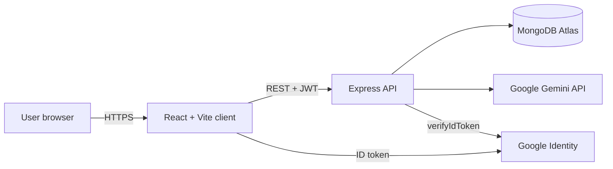
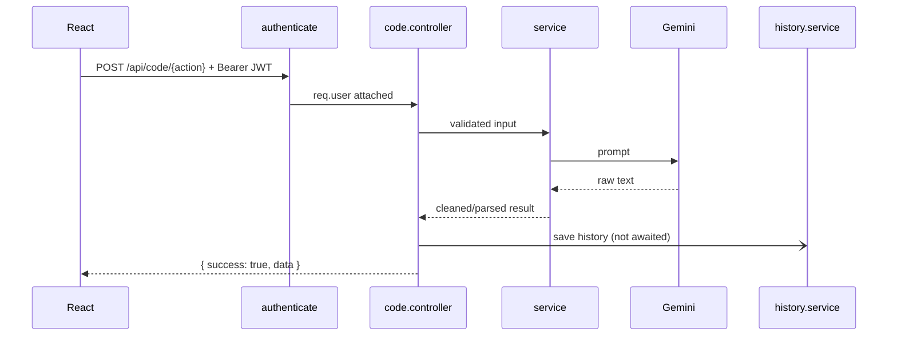

# 02 - Architecture

## System context



## Backend layers (strict, one direction)

```
routes -> middleware -> controller -> service -> model / external API
```

- **routes**: URL -> handler mapping, attach middleware only
- **middleware**: `authenticate`, validation, rate limiting, error handling
- **controller**: validate input, call service, shape the HTTP response. No business logic
- **service**: business logic and AI orchestration. No `req`/`res`
- **models**: Mongoose schemas only

## Request flow (all four code operations)



## Folder structure (exact, from the guide)

```
smart-code-translater/
+-- client/src/{components,context,pages,services,constants,styles}
+-- server/
    +-- server.js
    +-- src/{config,constants,controllers,middleware,models,routes,services,utils}, app.js
```

## Server files

| Folder      | Files                                                                                                                                                  |
| ----------- | ------------------------------------------------------------------------------------------------------------------------------------------------------ |
| config      | db.config.js, google.config.js, gemini.config.js, env.config.js (H3)                                                                                   |
| constants   | languages.js, prompts.js                                                                                                                               |
| controllers | auth.controller.js, code.controller.js, history.controller.js                                                                                          |
| middleware  | auth.middleware.js, error.middleware.js, validate.middleware.js (H2)                                                                                   |
| models      | User.model.js, History.model.js                                                                                                                        |
| routes      | index.js, auth.routes.js, code.routes.js, history.routes.js                                                                                            |
| services    | auth.service.js, gemini.service.js, translation.service.js, complexity.service.js, optimization.service.js, explanation.service.js, history.service.js |
| utils       | jwt.utils.js, prompts.utils.js                                                                                                                         |

## Client files

| Folder     | Files                                                                                 |
| ---------- | ------------------------------------------------------------------------------------- |
| components | Navbar, ProtectedRoute, CodeEditor, LanguageSelector, OutputPanel, HistoryList (.jsx) |
| context    | AuthContext.jsx                                                                       |
| pages      | LoginPage.jsx, HomePage.jsx, HistoryPage.jsx                                          |
| services   | api.js, authService.js, codeService.js, historyService.js                             |
| constants  | languages.js                                                                          |
| styles     | index.css, login.css, components.css, navbar.css, home.css, output.css, history.css   |

## Provider stack (order matters)

`StrictMode > GoogleOAuthProvider > BrowserRouter > AuthProvider > App (+ Toaster)`

## Design principles

Single responsibility per file - one error path (`next(error)` -> global handler) - consistent envelope - least privilege
(every query scoped to `req.user._id`) - config via env only - AI output is untrusted input (parse, validate shape, never execute).
